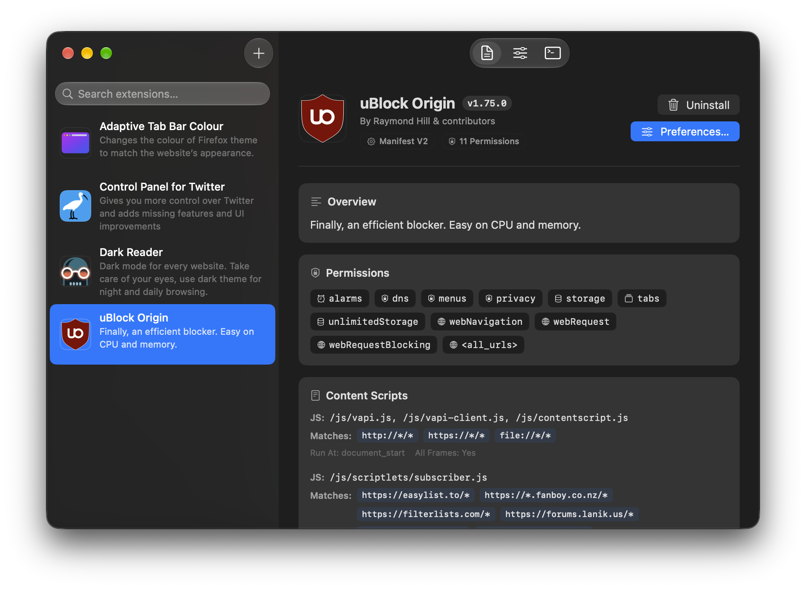
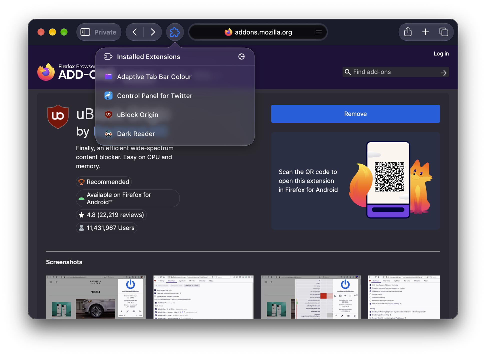

# Wirt

Run Chrome and Firefox extensions directly in Safari on macOS.

> [!TIP]
> Wirt is in a very early stage of development. Nothing is garanteed to work.

## Getting Started

1. Enable **Develop > Allow Unsigned Extensions** in Safari.
2. Turn on **Wirt** in **Safari > Settings > Extensions**.
3. Install extensions from the [Chrome Web Store](https://chromewebstore.google.com) or [Firefox Add-ons](https://addons.mozilla.org).
4. Click the extension toolbar icon in Safari to use installed extensions.

## Documentation

See [`docs/architecture.md`](docs/architecture.md) for technical architecture and design specifications.

## Licence

Wirt is distributed under the GNU General Public Licence v3.0. See [LICENSE](LICENSE) for details.
