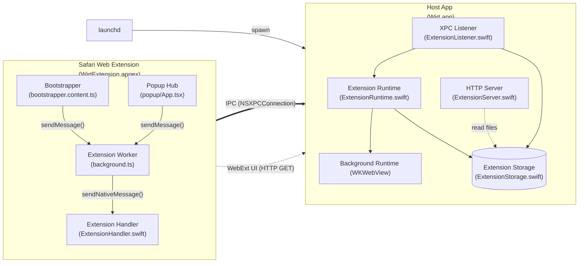
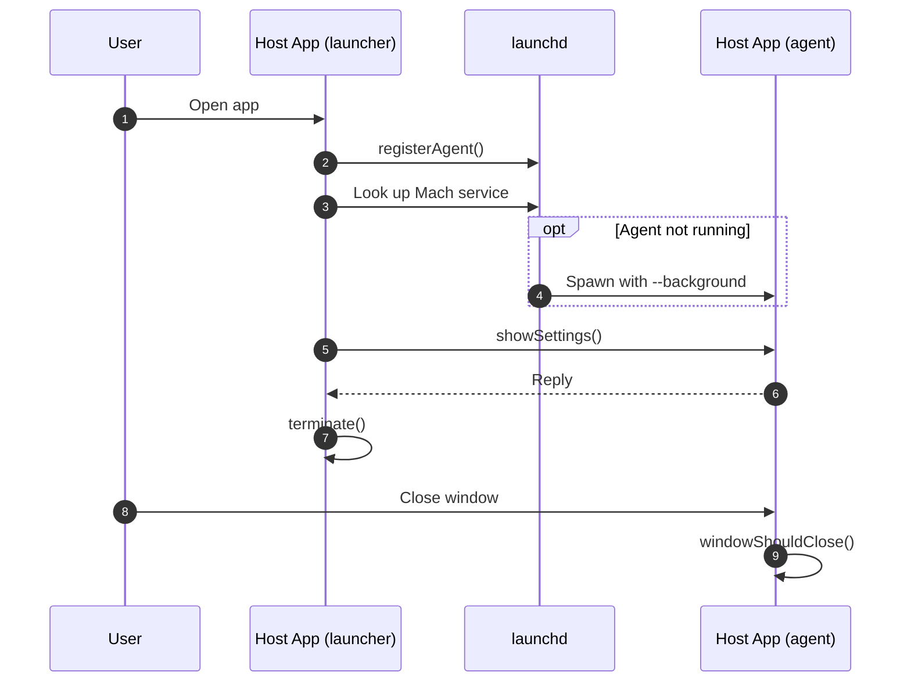
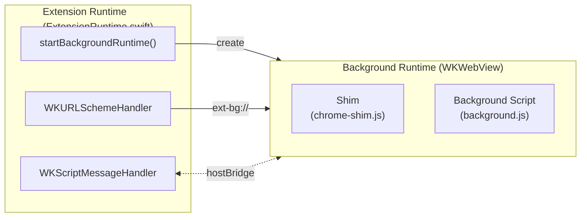
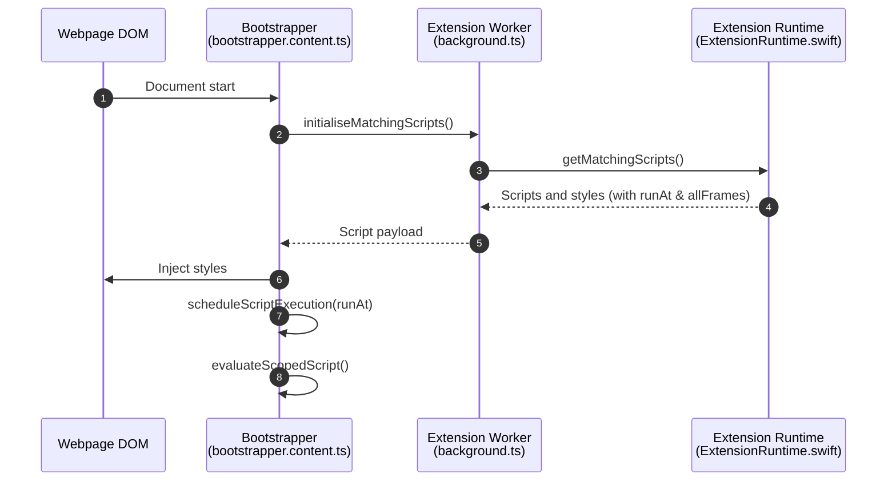
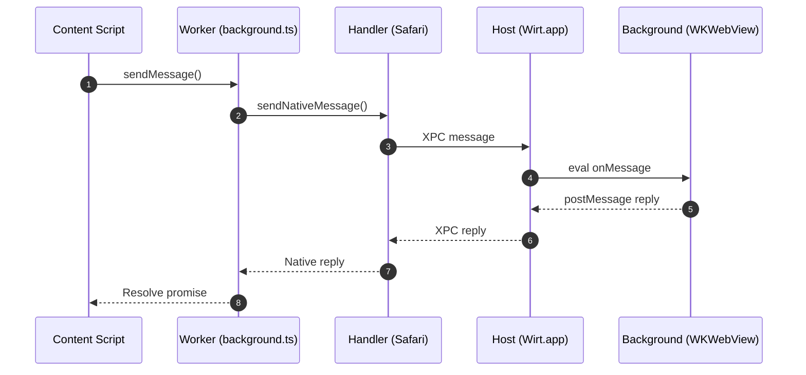
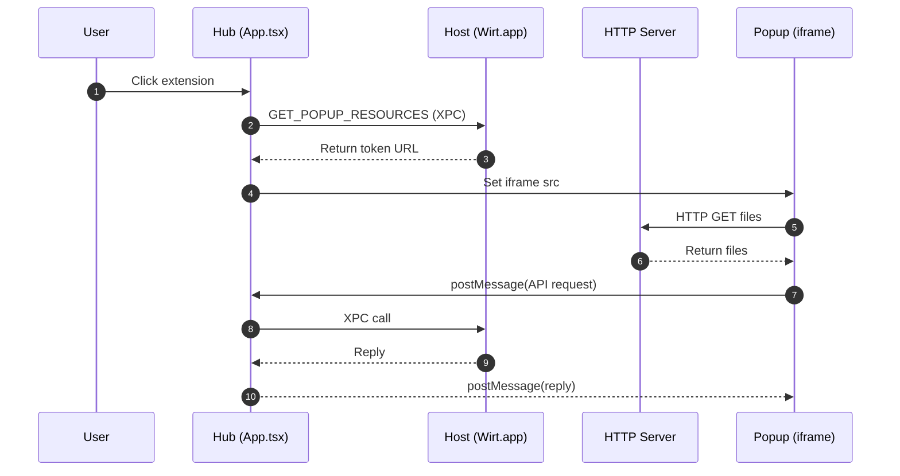
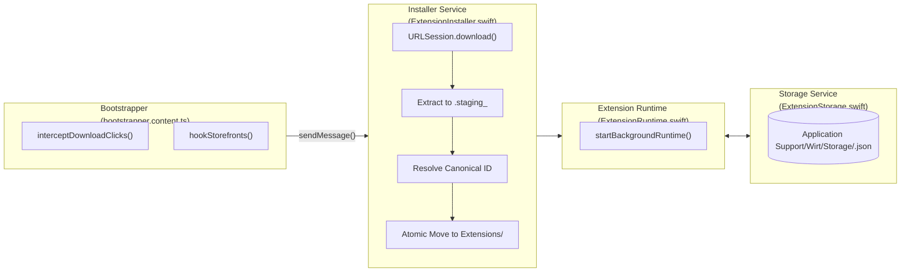

# System Architecture

## 1. System Overview

Wirt runs extension background scripts in WebViews inside a companion macOS app. Content scripts and popups run in Safari.



Two targets:

- `WirtExtension.appex`: Safari extension. Intercepts web requests, handles tabs, forwards messages.
- `Wirt.app`: macOS host app. Runs background WebViews, stores data, serves popup files.

---

## 2. Process Lifecycle and IPC

Host app runs as a `launchd` agent.



1. `launchd` manages Mach service (`de.easonwong.Wirt.mach`).
2. Safari wakes host on demand via XPC.
3. Host boots background WebViews for all installed extensions.
4. Opening `Wirt.app` calls `showSettings()` on running agent, then quits.
5. Closing settings window hides UI; process stays alive in background.
6. XPC connections are per-request to avoid stale sockets.

---

## 3. Background Script Execution

Host runs background scripts in headless `WKWebView` instances.



1. **Origin:** Custom scheme `ext-bg://<id>/` loads local files securely.
2. **CORS:** `webSecurityEnabled: false` allows cross-origin fetch.
3. **Shim:** `chrome-shim.js` injects `chrome.*` and `browser.*` APIs.
4. **Modules:** Renders `<script type="module">` for module workers.
5. **Bridge:** `hostBridge.postMessage()` sends calls to Swift; Swift invokes `__wirtBridgeCallback()` to resolve Promises.

---

## 4. Content Script Injection

Content scripts run directly in webpage DOM.



1. `bootstrapper.content.ts` runs on `<all_urls>` at `document_start`.
2. Bootstrapper asks host for scripts matching URL.
3. Matches respect `run_at` (`start`, `end`, `idle`) and `all_frames`.
4. CSS injects via `<style>` tags.
5. Scripts evaluate inside isolated function wrappers.

---

## 5. Inter-Process Messaging

Content scripts and host runtime communicate via native message bus.



### IPC Envelope

```json
{
	"correlationId": "e5c2b0d3-1111-4444-8888-abcdef012345",
	"extensionId": "ext_sample",
	"payload": { "action": "checkRule" },
	"source": { "tabId": 14, "frameId": 0, "url": "https://example.co.uk" },
	"type": "RUNTIME_SEND_MESSAGE"
}
```

- Content script calls `browser.runtime.sendMessage()`.
- Worker forwards via `sendNativeMessage()`.
- `ExtensionHandler` routes over XPC to host app.
- Host runs script in target `WKWebView` and returns reply.

---

## 6. Toolbar Actions and Popups

Safari has one toolbar icon. Wirt popup hub hosts all extensions.



- **Popup (`actionType: "popup"`):**
    1. Hub requests popup URL with token via XPC.
    2. Hub sets `iframe.src = "http://127.0.0.1:<port>/<token>/<id>/<path>"`.
    3. `ExtensionServer.swift` serves files on `127.0.0.1`. Validates `Host` and token.
    4. Popup uses `window.parent.postMessage()` for API calls.
    5. Hub forwards calls to host via XPC and returns replies.
- **Click (`actionType: "click"`):**
  Hub triggers `chrome.action.onClicked` in background runtime.
- **None (`actionType: "none"`):**
  Row disabled.

---

## 7. Package Installation and Storage

Host downloads, validates, unpacks, and stores extensions atomically.



1. **Interception:** Content script intercepts `.crx`/`.xpi` links and store install buttons.
2. **Staging:** Unpacks package into `.staging_<uuid>` after stripping CRX headers.
3. **ID Resolution:** Extracts ID from manifest or calculates SHA-256 base32 hash.
4. **Commit:** Renames staging folder to `Extensions/<id>/`.
5. **Storage:** `ExtensionStorage` persists `chrome.storage` data in `Storage/<id>.json`.
