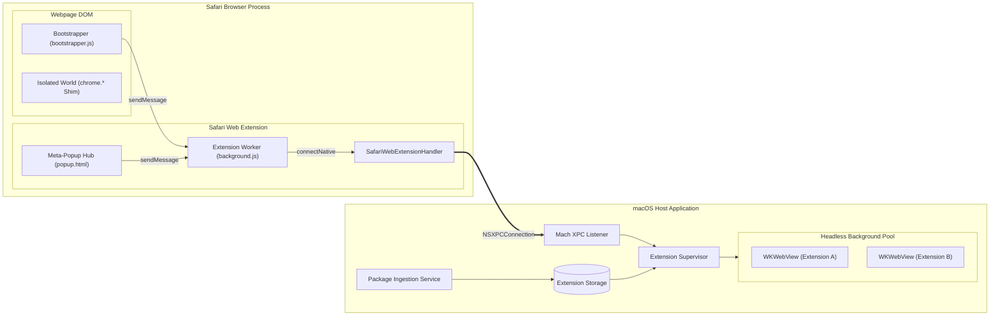
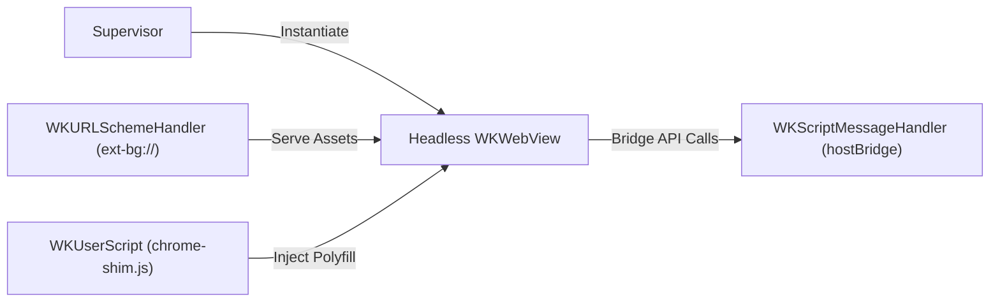
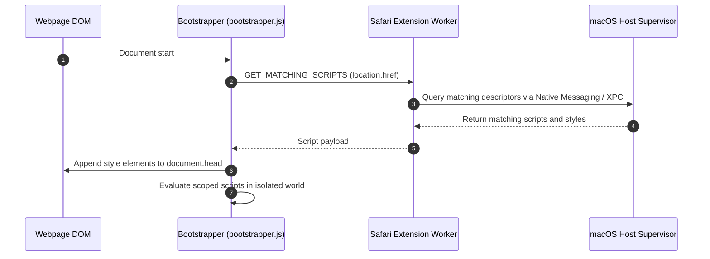
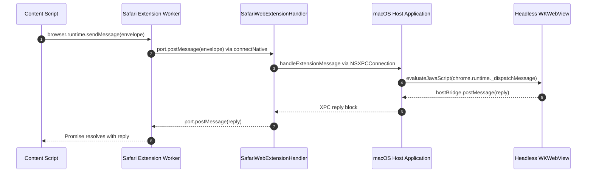
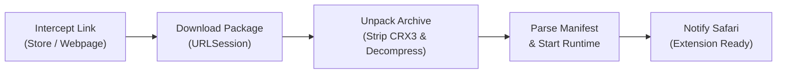
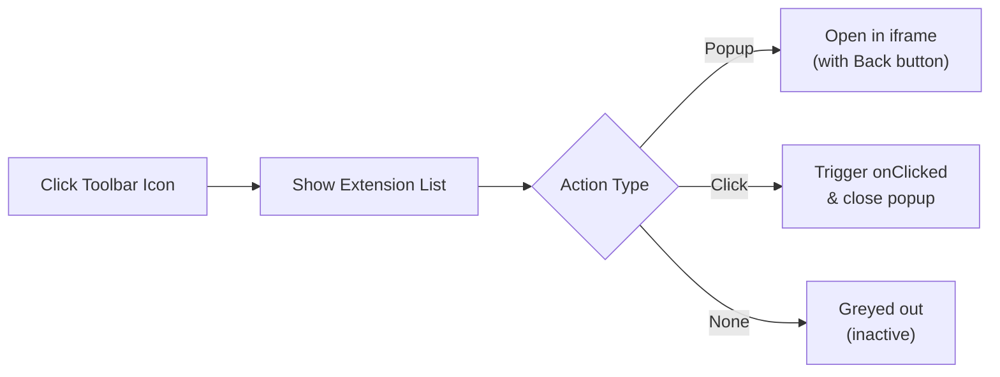

# System Architecture: Safari Extension Host

## 1. System Overview

The host runs third-party Chrome and Firefox extensions on Safari without modifying extension bundles.

Safari Web Extensions enforce a strict Content Security Policy (`script-src 'self'`) within extension service workers, prohibiting dynamic remote code execution. Downloaded background scripts execute inside headless `WKWebView` instances in the companion macOS application, while content scripts and user interfaces are bridged into Safari.



---

## 2. Running Background Scripts

Background scripts and service workers require standard browser Web APIs (DOM, Fetch, WebSockets, Storage).



1. **Origin Isolation:** Each extension is assigned an isolated origin via `ext-bg://<extension_id>/`. A custom `WKURLSchemeHandler` maps requests directly to the uncompressed package directory in `~/Library/Application Support/de.easonwong.SafariExtensionHost/Extensions/<extension_id>/`.
2. **Environment Injection:** Before loading background scripts, a `WKUserScript` injects the `chrome.*` and `browser.*` emulation layer at document start.
3. **Execution Harness:** The supervisor synthesises an HTML document loading background scripts in sequence:
    ```html
    <!DOCTYPE html>
    <html>
    	<head>
    		<meta charset="utf-8" />
    	</head>
    	<body>
    		<script src="ext-bg://<extension_id>/background.js"></script>
    	</body>
    </html>
    ```
4. **Outbound Bridging:** API calls from the background script dispatch through `window.webkit.messageHandlers.hostBridge.postMessage(...)` to Swift.

---

## 3. Injecting Content Scripts into Webpages

Content scripts are injected dynamically into web pages visited in Safari.



1. **Static Ingestion:** The Safari Extension registers a single static script (`bootstrapper.js`) matching `<all_urls>` at `document_start`.
2. **Rule Matching:** On initialisation, the bootstrapper requests scripts matching `window.location.href` from the host.
3. **Stylesheet Injection:** CSS rules are appended as `<style data-hosted-ext="<id>">` elements to `document.head`.
4. **Isolated World Evaluation:**
    - Safari runs content scripts in an isolated JavaScript world.
    - The bootstrapper constructs a local `chrome.*` shim.
    - Scripts are executed within a function scope to avoid global namespace conflicts:
        ```javascript
        function evaluateScopedScript(code, extensionId) {
        	const shim = createShim(extensionId);
        	const runner = new Function(
        		"chrome",
        		"browser",
        		"window",
        		"document",
        		code,
        	);
        	runner(shim, shim, window, document);
        }
        ```

---

## 4. Messaging Between Scripts and Background Runtimes

Communication between Safari content scripts and headless background runtimes traverses a multi-hop bus.



### IPC Envelope Format

```json
{
	"correlationId": "e5c2b0d3-1111-4444-8888-abcdef012345",
	"extensionId": "ext_sample",
	"type": "RUNTIME_SEND_MESSAGE",
	"source": {
		"tabId": 14,
		"frameId": 0,
		"url": "https://example.co.uk"
	},
	"payload": {
		"action": "checkRule"
	}
}
```

- **Native Messaging:** `background.js` forwards envelopes via `browser.runtime.sendNativeMessage("application.id", envelope)`.
- **Process Relay:** `SafariWebExtensionHandler` connects to the Host application via an `NSXPCConnection` bound to Mach service `de.easonwong.SafariExtensionHost.mach`.

---

## 5. Intercepting and Installing Web Extensions

Packages are intercepted and unpacked automatically when downloaded.



1. **Click & Store Interception:**
    - Content script intercepts `<a>` downloads ending in `.crx` or `.xpi`.
    - Storefront hooks detect "Add to Chrome" buttons on `chromewebstore.google.com` and construct direct CRX3 download links (`clients2.google.com/service/update2/crx`).
    - `browser.webNavigation.onBeforeNavigate` acts as a fallback for direct address bar navigations.
2. **Extraction:**
    - CRX3 packages begin with magic bytes `0x43 0x72 0x32 0x34` (`Cr24`).
    - The binary unpacker reads the header length, advances to the embedded ZIP payload, and extracts files into the sandboxed application directory.

---

## 6. Forwarding Extension Popups and Toolbar Actions

Safari supports only one static toolbar button declared in `manifest.json`. The host provides a dynamic meta-popup interface (`popup.html`).



### Action Types

1. **Popup Action (`actionType: "popup"`):** Transitions the meta-popup into an embedded view. An `<iframe>` loads `ext-ui://<id>/<popupPath>` with a navigation header to return to the list.
2. **Click Action (`actionType: "click"`):** Forwards an `ACTION_CLICKED` envelope with current tab details to the background runtime, triggers `chrome.action.onClicked`, and closes the popup immediately.
3. **Passive Action (`actionType: "none"`):** Extensions without toolbar controls appear with reduced opacity (`0.45`) and disabled click interaction.
