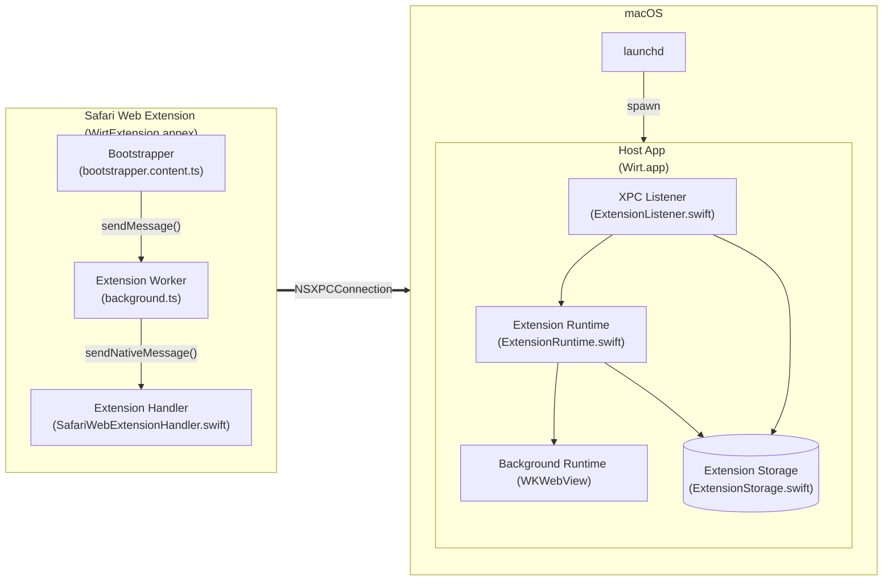
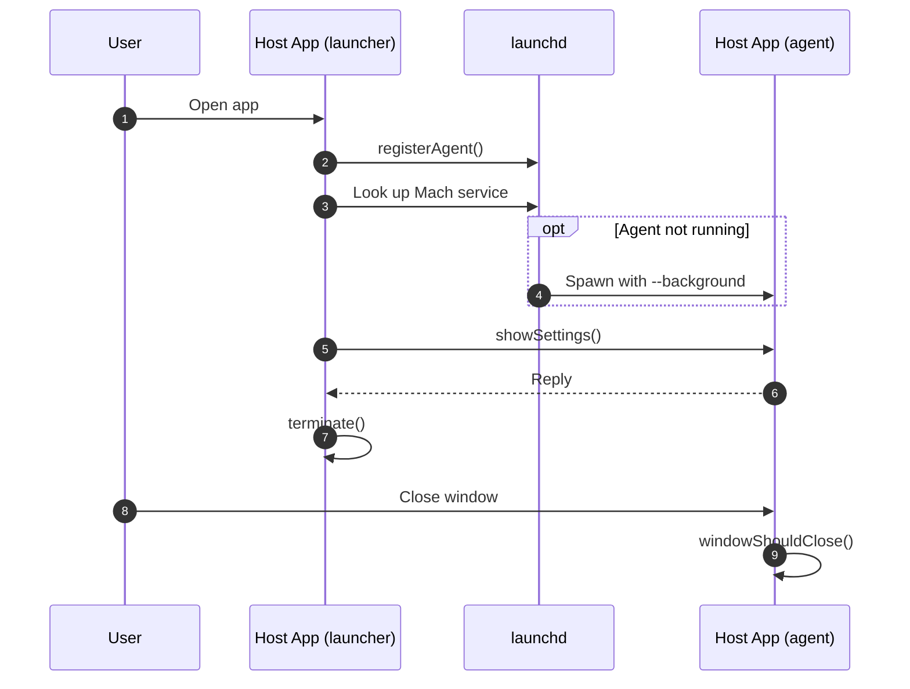
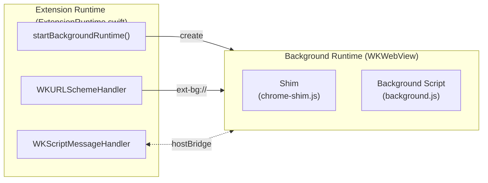
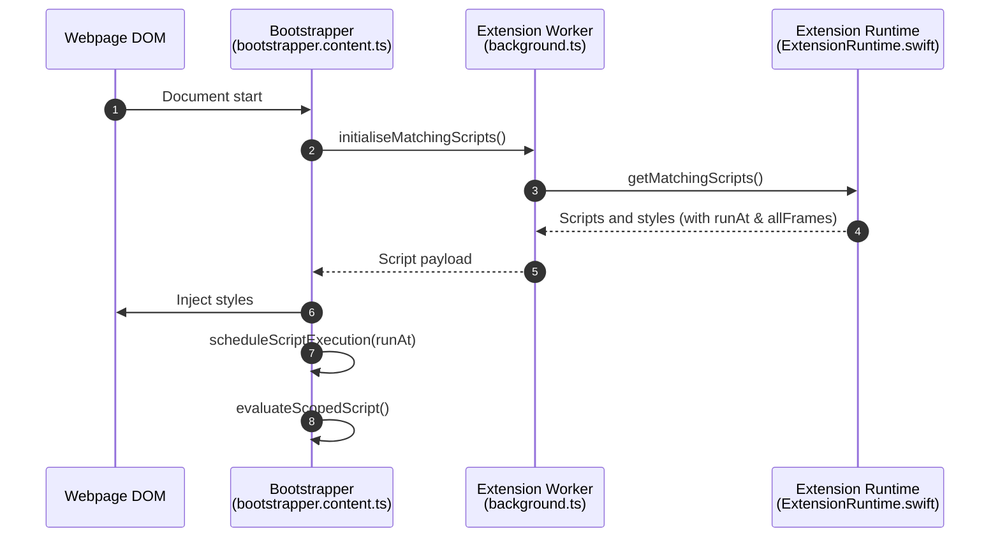
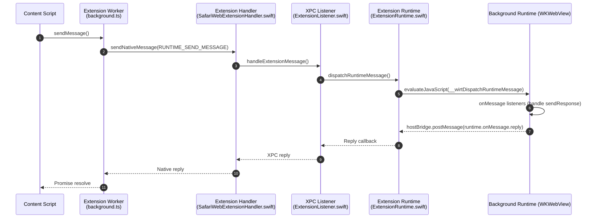
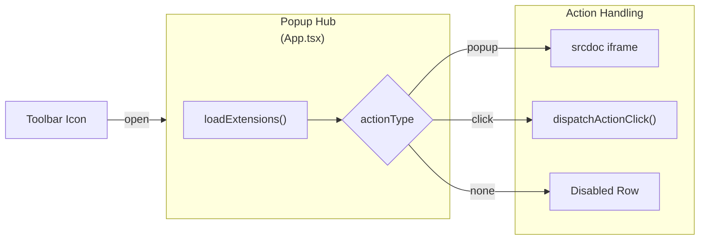
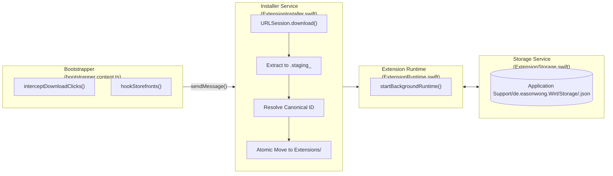

# System Architecture

## 1. System Overview

Wirt runs unmodified Chrome and Firefox extensions in Safari.

Safari Web Extensions enforce a strict Content Security Policy (`script-src 'self'`). Therefore, dynamic remote script execution is prohibited inside the extension worker. To resolve this restriction, the host runs background scripts inside headless WebViews within a companion macOS application. Content scripts and extension popups remain inside Safari and bridge into the host application.



The system contains two bundle targets:

1. **Safari Extension Companion (`WirtExtension.appex`):** Runs inside Safari to intercept web requests, manage browser tabs, and forward native messages.
2. **Host Application (`Wirt.app`):** Runs on macOS to manage extension lifecycles, execute background scripts, and persist files.

---

## 2. Process Lifecycle and IPC

The host application operates as a background launch agent managed by `launchd`.



1. **Launch Agent Registration:** On initial startup, the host registers `de.easonwong.Wirt.agent.plist` through `SMAppService.agent(plistName:)`. The plist assigns ownership of the Mach service `de.easonwong.Wirt.mach` to `launchd`.
2. **On-Demand Activation:** When Safari sends a request, `SafariWebExtensionHandler` resolves the Mach service. If the host is not running, `launchd` starts `Wirt` with `--background`.
3. **Automatic Runtime Boot:** On application startup (either foreground or `--background`), `ExtensionRuntime.bootInstalledExtensions()` scans the storage directory and launches background WebViews for all installed extensions.
4. **Single-Instance Hand-off:** When a user launches `Wirt.app` directly, the new instance registers the agent and sends an XPC `showSettings()` call to the active Mach service. The launcher then terminates itself immediately.
5. **Headless Background Execution:** When the user closes the settings window, the application hides the window and sets its policy to `.accessory`. The process remains active silently to retain in-memory background runtimes.
6. **Transient XPC Connections:** `SafariWebExtensionHandler` creates and invalidates an `NSXPCConnection` for each incoming request. This prevents stale sockets across extension reloads.

---

## 3. Background Script Execution

Background scripts and extension service workers require standard browser Web APIs, such as DOM, Fetch, and WebSockets. The host provides these environments through headless `WKWebView` instances.



1. **Origin Isolation:** Each extension receives an isolated origin (`ext-bg://<extension_id>/`). A custom `WKURLSchemeHandler` serves files directly from the extension storage directory on disk, with path traversal validation against parent directory boundaries.
2. **CORS and Network Capabilities:** Host `WKWebView` instances configure `webSecurityEnabled: false` to allow background scripts and service workers to fetch remote endpoints without standard browser origin CORS rejections.
3. **Environment Injection:** Before loading background scripts, a `WKUserScript` injects the `chrome.*` and `browser.*` polyfill (`chrome-shim.js`) at document start.
4. **Module Worker Support:** If an extension manifest specifies `"type": "module"`, the execution harness synthesises `<script type="module" src="...">` tags; otherwise, classical `<script src="...">` tags are used:
    ```html
    <!DOCTYPE html>
    <html>
    	<head>
    		<meta charset="utf-8" />
    	</head>
    	<body>
    		<script type="module" src="service_worker.js"></script>
    	</body>
    </html>
    ```
5. **Bridge Dispatch & Asynchronous Callbacks:** API requests from the background runtime post messages through `window.webkit.messageHandlers.hostBridge.postMessage(...)` with a unique `requestId`. The Swift runtime evaluates `window.__wirtBridgeCallback(...)` to resolve corresponding Promises.

---

## 4. Content Script Injection

Content scripts run directly inside Safari webpages to interact with the DOM.



1. **Script Registration:** The Safari Extension registers a static script (`bootstrapper.content.ts`) matching `<all_urls>` at `document_start`.
2. **Rule Matching:** On initialisation, the bootstrapper requests scripts matching `window.location.href` from the host. Match patterns are strictly validated across scheme, host, and path components according to Chromium/Firefox specifications.
3. **Execution Timing (`run_at`):**
    - `document_start`: Evaluated immediately.
    - `document_end`: Dispatched on `DOMContentLoaded` or immediately if DOM is already parsed.
    - `document_idle`: Dispatched via `requestIdleCallback` after document load.
4. **Frame Filtering (`all_frames`):** Subframe execution is skipped if the content script declaration specifies `all_frames: false`.
5. **Stylesheet Injection:** CSS rules are appended as `<style data-hosted-ext="<id>">` elements into `document.head` or `document.documentElement`.
6. **Isolated World Evaluation:** The bootstrapper evaluates matched scripts inside an isolated function scope to avoid namespace conflicts:
    ```javascript
    function evaluateScopedScript(code, extensionId, scriptPath) {
    	const shim = createShim(extensionId);
    	const runner = new Function(
    		"chrome",
    		"browser",
    		"window",
    		"document",
    		`${code}\n//# sourceURL=ext://${extensionId}/${scriptPath}`,
    	);
    	runner(shim, shim, window, document);
    }
    ```

---

## 5. Inter-Process Messaging

Communication between content scripts, the Safari extension, and background runtimes traverses a structured messaging bus.



### IPC Envelope Format

Messages share a standardised envelope structure:

```json
{
	"correlationId": "e5c2b0d3-1111-4444-8888-abcdef012345",
	"extensionId": "ext_sample",
	"type": "RUNTIME_SEND_MESSAGE",
	"source": {
		"tabId": 14,
		"frameId": 0,
		"url": "https://example.co.uk"
	},
	"payload": {
		"action": "checkRule"
	}
}
```

- Content scripts dispatch envelopes using `browser.runtime.sendMessage(...)`.
- The Extension Worker relays envelopes to the native handler through `browser.runtime.sendNativeMessage(...)`.
- The native handler passes requests to the host over `NSXPCConnection`.
- The host delivers payloads into the target background `WKWebView` and awaits `sendResponse` resolution before completing the XPC transaction.

---

## 6. Toolbar Actions and Popups

Safari permits only one static toolbar button per extension bundle. Therefore, the host provides a dynamic popup hub (`popup/App.tsx`).



The hub inspects the declared action for each installed extension:

- **Popup Action (`actionType: "popup"`):** Fetches popup HTML, scripts, and stylesheets via `GET_POPUP_RESOURCES` over native messaging and renders the content inside a sandboxed `srcdoc` `<iframe>`. This avoids WebKit's security restrictions against custom URI schemes inside extension popups.
- **Click Action (`actionType: "click"`):** Forwards a click event envelope to the background runtime, triggers `chrome.action.onClicked`, and closes the popup hub.
- **Passive Action (`actionType: "none"`):** Displays an inactive entry when no toolbar interaction is declared.

---

## 7. Package Installation and Storage

The host downloads, validates, unpacks, and stores web extension packages using a two-phase atomic staging workflow.



1. **Download Interception:** The content script intercepts links ending in `.crx` or `.xpi`. Storefront hooks detect installation buttons on Chrome Web Store and AMO pages, replacing them with native "Add to Safari" triggers.
2. **Two-Phase Staging:** Packages are extracted into an ephemeral `.staging_<uuid>` directory first. CRX3 and CRX2 binary headers are skipped using unaligned byte loading before extracting the embedded ZIP payload.
3. **Canonical ID Resolution:**
    - Firefox add-ons: Read `browser_specific_settings.gecko.id` or `applications.gecko.id` from `manifest.json`.
    - Chrome extensions: Derived from download URL query parameters (`x=id=...` or `id=...`) or computed via SHA-256 base32 hashing of `manifest.json`'s `key` field.
    - Identifiers are sanitized with `^[a-zA-Z0-9._@-]+$`.
4. **Atomic Commit:** The staging directory is moved atomically into `~/Library/Application Support/de.easonwong.Wirt/Extensions/<canonical_id>/`.
5. **Key-Value Storage Persistence:** `ExtensionStorage` provides thread-safe, atomic key-value persistence for `chrome.storage.local` and `chrome.storage.sync` under `~/Library/Application Support/de.easonwong.Wirt/Storage/<canonical_id>.json`.
